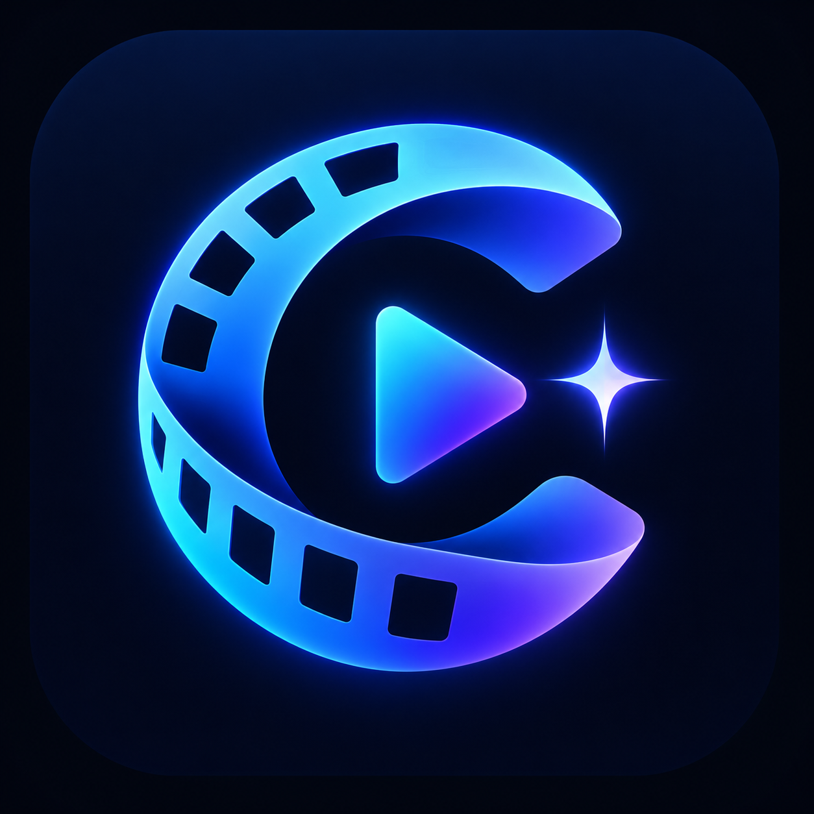

# Cinearis 🎬

<p align="center">
  
</p>

**KI-gestützte Entdeckung, Organisation und Verwaltung von Filmen, Serien und Animes.**

Cinearis ist Teil des **Novarion-Ökosystems**. Die selbst gehostete Webanwendung erkennt Titel aus Bildern und – soweit technisch und rechtlich zugänglich – Social-Media-Beiträgen, erstellt eine dauerhaft wachsende persönliche Merkliste und gleicht diese mit **Jellyfin / Velaris** ab. Eine spätere Verbindung zu **ForgeCore** ist geplant.

> **Projektstatus:** Planung · Zielversion: **v0.1.0** · Die folgenden Funktionen sind geplant, noch nicht implementiert.

## ✨ Geplante Funktionen

- **Bilderkennung:** Poster, Screenshots, Collagen, Szenen und Texteinblendungen mit Vision-KI und OCR analysieren.
- **Instagram-Import:** Beitrags-Links analysieren, soweit erlaubte Schnittstellen oder zugängliche Medien dies ermöglichen; manueller Screenshot-/Bild-Upload als verlässlicher Fallback.
- **Medien-Abgleich:** Titel, Originaltitel und alternative Schreibweisen über **TMDB** (Filme/Serien) und **AniList** (Anime) zuordnen.
- **Persönliche Watchlist:** Kategorien, Filter, Suche und Status wie *Fehlt*, *Wunschliste*, *Geplant*, *In Bearbeitung*, *Vorhanden*, *Ignoriert*.
- **Jellyfin-Integration:** Vorhandene Medien automatisch zuordnen; bei Serien und Animes perspektivisch Staffel- und Episodenabdeckung anzeigen.
- **Dubletten vermeiden:** Externe IDs und Aliasnamen statt bloßem Textvergleich nutzen.
- **Quellennachweis:** Nachhalten, in welchen Beiträgen oder Uploads ein Titel gefunden wurde.
- **Statistiken:** Erfasste, vorhandene und fehlende Titel; besonders häufig genannte Empfehlungen.
- **ForgeCore-Anbindung:** Fehlende Titel später gezielt an ForgeCore übergeben, ohne ungeprüfte automatische Downloads.

## 🗺️ Roadmap

Alle Phasen sind **geplant**. Versionen bezeichnen Entwicklungsziele, keine bereits veröffentlichten Releases.

| Phase | Zielversion | Umfang | Abnahmekriterium |
| --- | --- | --- | --- |
| 1 – Fundament | **v0.1.0** | React/TypeScript-Frontend, FastAPI-Backend, PostgreSQL, Docker Compose, Basis-UI, Konfiguration | Anwendung startet lokal und unter ZimaOS, Healthcheck erfolgreich |
| 2 – Bildanalyse | **v0.2.0** | Einzel-/Mehrfach-Upload, OCR, austauschbarer Vision-KI-Anbieter, Konfidenz und manuelle Bestätigung | Titelvorschläge werden aus Testbildern angezeigt und korrigierbar gespeichert |
| 3 – Metadaten | **v0.3.0** | TMDB/AniList-Suche, Titel-Aliase, Poster, Jahreszahlen, ID-Mapping | Erkannte Titel können zuverlässig mit Datensätzen verknüpft werden |
| 4 – Mediensammlung | **v0.4.0** | Watchlist, individuelle Status, Filter, Suche, Bearbeiten, Duplikatschutz | Wiederholte Erkennung erzeugt keine doppelten Titel |
| 5 – Jellyfin | **v0.5.0** | Sichere API-Anbindung, Bibliotheksabgleich, Titel- und Staffel-/Episodenstatus | Vorhandene und teilweise vorhandene Titel werden nachvollziehbar markiert |
| 6 – Instagram | **v0.6.0** | Link-Import unter Beachtung der Plattformbeschränkungen, unterstützte Mehrbildbeiträge, Upload-Fallback | Zugängliche Beiträge werden verarbeitet; nicht zugängliche sauber abgefangen |
| 7 – Insights | **v0.7.0** | Dashboard, Quellenhistorie, Fundhäufigkeit, Prüf- und Fehlerübersicht | Statistiken und Herkunft pro Titel sind nachvollziehbar |
| 8 – Integration & Release | **v1.0.0** | ForgeCore-Schnittstelle, PWA-Grundfunktionen, Tests, Backups, Sicherheit, Dokumentation | Stabiler, dokumentierter Docker-Release für den Heimserver |

### Spätere Ideen (nach v1.0.0)

- Reel-/Video-Frame-Analyse, soweit zugänglich
- Weitere Quellen wie TikTok, YouTube, Pinterest und Reddit
- Automatisierbare Import-Workflows nur mit berechtigtem Zugriff
- Optionaler lokaler Vision-KI-Anbieter für datenschutzfreundliche Verarbeitung

## 🧱 Geplante Architektur

| Bereich | Technologie |
| --- | --- |
| Frontend | React, TypeScript, Tailwind CSS |
| Backend / API | Python, FastAPI |
| Datenbank | PostgreSQL |
| Vision / Texterkennung | Austauschbarer Vision-KI-Anbieter und OCR |
| Metadaten | TMDB, AniList |
| Mediathek | Jellyfin API |
| Deployment | Docker Compose auf ZimaOS / Linux |

Die technischen Entscheidungen können sich mit der Entwicklung ändern.

## 📁 Zielstruktur

```text
Cinearis/
├── assets/
│   ├── .gitkeep
│   ├── Cinearis.png          # offizielles Projektlogo
│   └── favicon.ico           # Browser-Favicon (vorbereitet)
├── frontend/                 # ab Phase 1
├── backend/                  # ab Phase 1
├── database/                 # ab Phase 1
├── docker/                   # ab Phase 1
├── docs/                     # ab Phase 1
├── .env.example              # ab Phase 1
├── docker-compose.yml        # ab Phase 1
└── README.md
```

Das offizielle Cinearis-Logo liegt bereits unter **`assets/Cinearis.png`** und wird oben in dieser README angezeigt. Aus diesem Motiv wurden Favicon-Varianten (16 × 16, 32 × 32, 48 × 48, .ico, Apple Touch und PWA) vorbereitet; die generierten Varianten müssen noch in `assets/` hochgeladen werden.

Sobald `assets/favicon.ico` vorhanden ist, kann die Website z. B. so darauf verweisen:

```html
<link rel="icon" type="image/x-icon" href="/assets/favicon.ico" />
<link rel="icon" type="image/png" sizes="32x32" href="/assets/favicon-32x32.png" />
<link rel="apple-touch-icon" href="/assets/apple-touch-icon.png" />
<link rel="manifest" href="/assets/site.webmanifest" />
```

Bei einem späteren Build werden die Dateien im statischen öffentlichen Verzeichnis bereitgestellt.

## 🔐 Datenschutz & Sicherheit

- API-Keys, Jellyfin-Zugangsdaten und Passwörter gehören **niemals ins Git-Repository**; für lokale Konfiguration `.env` verwenden.
- Instagram-Inhalte nur über zulässige Zugangswege bzw. vom Nutzer bereitgestellte Dateien verarbeiten.
- Externe Bilder können an einen konfigurierten KI-Anbieter gesendet werden; dies muss transparent und abschaltbar sein.
- Medien-Treffer der KI sind Vorschläge, keine garantierten Identifizierungen; unsichere Treffer müssen überprüfbar sein.
- Jellyfin zunächst mit möglichst eingeschränkten Zugriffsrechten anbinden.

## 🧩 Novarion

- **Velaris / Jellyfin:** Mediatheksbestand prüfen
- **ForgeCore:** Medien-Wunschliste und spätere Übergabe
- **Cinearis:** Neue Titel entdecken, erkennen und organisieren

## 📌 Entwicklungsstand

- [x] Repository und Entwicklungs-Roadmap
- [x] Assets-Ordner und Projektlogo
- [ ] Generierte Favicon-Varianten ins Repository hochladen
- [ ] v0.1.0 – Projektfundament
- [ ] v0.2.0 – Bildanalyse
- [ ] v0.3.0 – Metadaten
- [ ] v0.4.0 – Sammlung
- [ ] v0.5.0 – Jellyfin
- [ ] v0.6.0 – Instagram
- [ ] v0.7.0 – Insights
- [ ] v1.0.0 – Release

---

**Cinearis** · Teil des **Novarion-Ökosystems**
